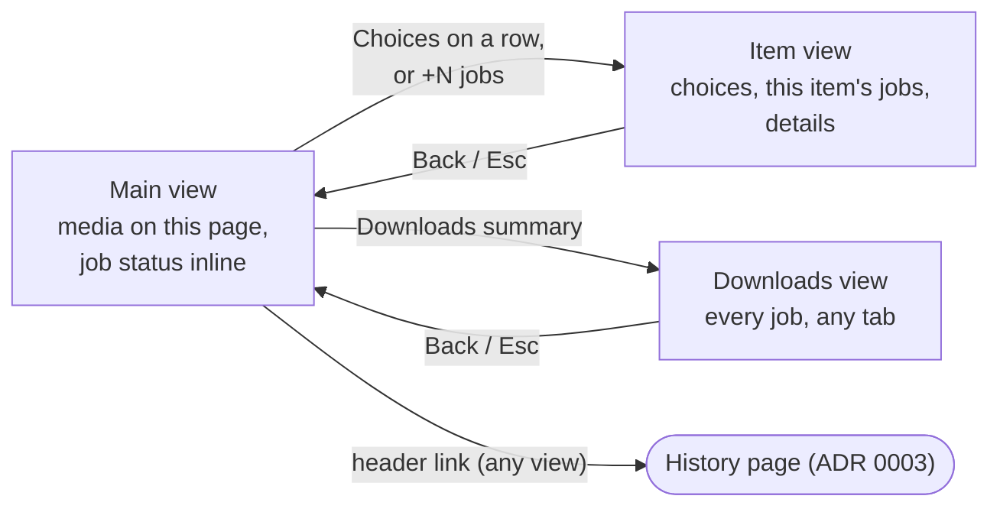

# 0005. Popup structure: page list with inline jobs, item and Downloads views

- Status: proposed
- Date: 2026-10-25
- Issue: #9

## Context

The popup holds two collections in a 380px column ([brief](../brief.md#constraints)):

- **Media on this page:** `media/list { tabId }`, kept current by `media/updated`, cleared when the tab navigates.
- **Downloads:** `download/list {}`, kept current by `job/updated` and `job/removed`. It is **global** and persists until `download/remove`. A job has no tab or page field; it links to its media only through `mediaId`, which "may no longer be in the tab list" (contract §2.2). So "this page's jobs" means jobs whose `mediaId` is in the current `media/list`; every other job, from another tab or from a page the tab left, is `JOB-MEDIA-GONE` and has only `outputName` (G11).

One item can have several jobs (video and MP3; a failed job and its retry, D-F3). A queued job can wait on a job from another tab (`waiting.blockingJobId`, F6).

The [core flows](../flows/core-flows.md#flow-decisions-and-constraints-for-the-ia) fix what the structure must allow: save on the item in one click (D-F1), started feedback in the same view within 1 s (J3), pause, resume, cancel and stop each 1 click from the job (J3), retry 1 click from a failed job (J4), choices at most 2 extra clicks with radio-like options (constraint 2), the media list as one tab stop (constraint 1), Stop and Cancel never interchangeable (constraint 3), and one visible History link ([ADR 0003](0003-history-own-page.md)).

### Options evaluated

**A.** Two tabs, This page / Downloads. **B.** One list where each item carries its job inline, plus a compact queue section below. **C.** A list with a slide-over detail view for choices and progress. Clicks are counted after the popup is open, as in [persona §5](../discovery/persona.md#5-success-criteria-per-task).

| Criterion                    | A. Two tabs                                                                                                                                       | B. Inline + queue section                                                                                                      | C. List + slide-over                                                                                           |
| ---------------------------- | ------------------------------------------------------------------------------------------------------------------------------------------------- | ------------------------------------------------------------------------------------------------------------------------------ | -------------------------------------------------------------------------------------------------------------- |
| F1 save with defaults        | 1 click, but progress appears on the other tab: no feedback where the click happened (fails J3) unless the popup switches tab, which moves focus. | 1 click; progress replaces the button on the same row.                                                                         | 1 click if the row keeps Download (D-F1); progress is not visible until the item is opened (fails J3).         |
| F2 choices                   | Expand in the row: +2.                                                                                                                            | Expand in the row: +2, but quality, audio, subtitles and MP3 groups make one row taller than the popup at 380px and +40% text. | Open, pick: +2, with room for the groups and their details ([progressive disclosure](../process.md#glossary)). |
| F1/F5 pause, cancel, stop    | Switch tab + 1 = 2.                                                                                                                               | 1 for this page's jobs; others: scroll to the section + 1.                                                                     | Open + 1 = 2 (fails J3); several jobs cannot be watched at once.                                               |
| F3 why it failed, retry      | Clear on Downloads, 2 clicks to retry.                                                                                                            | Retry 1 click; the full explanation and details inflate the row.                                                               | Clear in the detail; retry 2 clicks (fails J4).                                                                |
| F6 header conflict           | Waiting job and blocker on one list.                                                                                                              | The blocker may sit in another section.                                                                                        | The blocker is unreachable if its media left the tab.                                                          |
| Discoverability              | Counts on the tab label; the default tab hides the other collection.                                                                              | Media and its status together; a queue section under a long list is out of sight.                                              | Status hidden until opened.                                                                                    |
| 1 item                       | Tab bar is overhead and an extra concept for the commonest case; Downloads tab often empty.                                                       | Best fit.                                                                                                                      | An extra step to watch the only thing on the page.                                                             |
| 20 items (`MEDIA-LONG-LIST`) | Scales.                                                                                                                                           | Long, uneven rows; the queue section is far below.                                                                             | Compact; scales.                                                                                               |
| Job whose media left the tab | Natural home on Downloads.                                                                                                                        | Only in the queue section, below the fold.                                                                                     | **No home**: unreachable.                                                                                      |
| History link (J5 ≤ 2)        | Header, 1.                                                                                                                                        | Header, 1.                                                                                                                     | Header, 1.                                                                                                     |

No option works on its own: A scales and houses orphaned jobs but loses save feedback; B gives the best feedback with one item but breaks at 20 items and for orphaned jobs; C has room for choices but hides progress and loses orphaned jobs.

## Decision

The popup has one **main view** and two **drill-down views** ([master–detail](../process.md#glossary)), plus a fixed header.

1. **Header** (every view): the History link (hidden while `history/list` answers `unknown-request`), the Settings link (hidden until the options page exists, M5), and the discreet `NET-RECONNECTING` note.
2. **Main view = this page's media list** (B's strength). Rows have a fixed two-line anatomy so 20 items stay scannable: identity (thumbnail or placeholder, title or fallback, duration) and an **action line**.
   - No job: **Download** (defaults, D-F2) and **Choices**, which opens the item view. Live items say they record.
   - With a job, its **compact status** takes the action line: progress or a short status, and every 1-click control J3 and J4 require for that status: Pause/Resume and Cancel; for live, a labeled "Stop and keep" apart from Cancel (constraint 3); Retry and Dismiss for failures, except `ERR-PROTECTED`, which shows the calm protected explanation and Dismiss only (never Retry), in every variant. Each control follows the `unknown-request` fallbacks of the flows (hidden or disabled while its method is unsupported), and Stop also needs the media to be known live (G4). Relevance when an item has several jobs: running, paused, queued, failed, done; the rest show as "+N" and open the item view. A cancelled job does not take the row; Download comes back.
   - Errors and waiting show the next step in a short form only; the full explanation, F6 blocker controls and technical details live in the item view. If the short `ERR-HTTP-AUTH` next step does not fit at +40% (#11), failed rows may take one more line: they need attention, so the exception is acceptable.
   - Choices stays available on every available row, so a second job (for example MP3) is always reachable.
   - Protected rows (`MEDIA-PROTECTED`) have no download controls: a calm label and an inline "why" disclosure (F4), no Choices, never Download or Retry.
3. **Item view** (C's strength): quality, audio, subtitle and audio-only choices as radio-like groups, a Download button, the item's jobs as full job cards (F3 explanation and Retry, except `ERR-PROTECTED`, F6 "Waiting for …" with the blocker's Stop/Pause/Cancel), and technical details. Saving here keeps the user in the item view; the new job appears in it within 1 s (J3).
4. **Downloads view** (A's strength): every job from `download/list` as full job cards, grouped as needs attention (failed, waiting), active (running, paused, queued), finished (done, cancelled); `download/list` order inside each group (G14 fallback). It is the home of jobs whose media left the tab and of cross-tab F6 blockers. This page's jobs appear here too: one job, rendered in two places.
5. **Downloads summary**, pinned at the bottom of the main view whenever `download/list` is not empty, with counts such as "2 downloading · 1 needs attention"; it opens the Downloads view. With no jobs it is not rendered (`PAGE-QUEUE-EMPTY`). It also stays on `PAGE-EMPTY` and `PAGE-ALL-PROTECTED`, so active jobs remain one click away.
6. **Drill-down behavior**, shared by both views: the view replaces the main view in the popup, with Back and Esc; focus moves to the view heading on open and returns to the opener on Back; transitions respect `prefers-reduced-motion`; the view re-renders from events while open. If the item leaves `media/list` while its view is open, the view keeps its jobs, says the video is no longer on the page and disables new downloads. If a focused row disappears, focus moves to the list.

Resulting step counts: save with defaults 1; choices +2; pause, resume, cancel (+ confirm), stop, retry 1 from this page's rows and 2 from the main view for other jobs (summary, then control; A also needs 2); full explanation 1; History 1.

Wireframes (#11, #12) decide the visuals: row anatomy, summary copy, slide or swap, and the composite keyboard pattern that keeps the list one tab stop (constraint 1).

## Alternatives considered

- **A. Two tabs.** Rejected as the top level: saving gives no feedback where the click happened, and the tab bar costs height and a concept in the single-video case. Even with inline status added to This page, it differs from the decision only by making Downloads a permanent peer that is often empty. Its list is kept as the Downloads view.
- **B. Inline jobs plus a queue section.** Rejected as specified: inline choices and explanations make rows too tall, and a section below 20 items is undiscoverable. A variant whose section lists only other pages' jobs has the same fold problem and still needs a pinned entry point. Its compact inline status is kept, limited to the action line.
- **C. Slide-over for choices and progress.** Rejected as specified: progress and job controls sit behind a click (fails J3 and J4) and orphaned jobs have no home. Its slide-over is kept for choices and full job detail.
- **Earlier draft.** Same shape, written before #6 and #8. Changed here: the compact status had one primary control, which put Cancel 2 clicks away and failed J3; History was only reachable inside the Downloads view, which disappears when there are no jobs, failing ADR 0003's "one visible link".

## Consequences

- The commonest task, saving a video with defaults and watching it, takes one click on one screen.
- Every job is reachable at all times through the summary, including jobs from other tabs and after navigation.
- The job card component (#20) needs a compact variant (action line) and a full variant (item and Downloads views), from one status-to-controls mapping so both stay consistent.
- The compact action line is the tightest spot: live jobs need "Stop and keep", Pause and Cancel in about 280px at +40% text. #11 must test it; icon-only controls need accessible names and 24×24 CSS px targets minimum (WCAG 2.5.8).
- Focus and Back handling is built once for both drill-down views (#27, #33).
- Jobs whose media left the tab are identified only by `outputName` and cannot offer Stop (G11, G4); Downloads view order is undefined (G14). No new gap: the structure needs no tab field, because "this page" is resolved through `mediaId`.
- The structure maps to the Firefox sidebar (#37): with room, the drill-down views can sit beside the list instead of replacing it.
