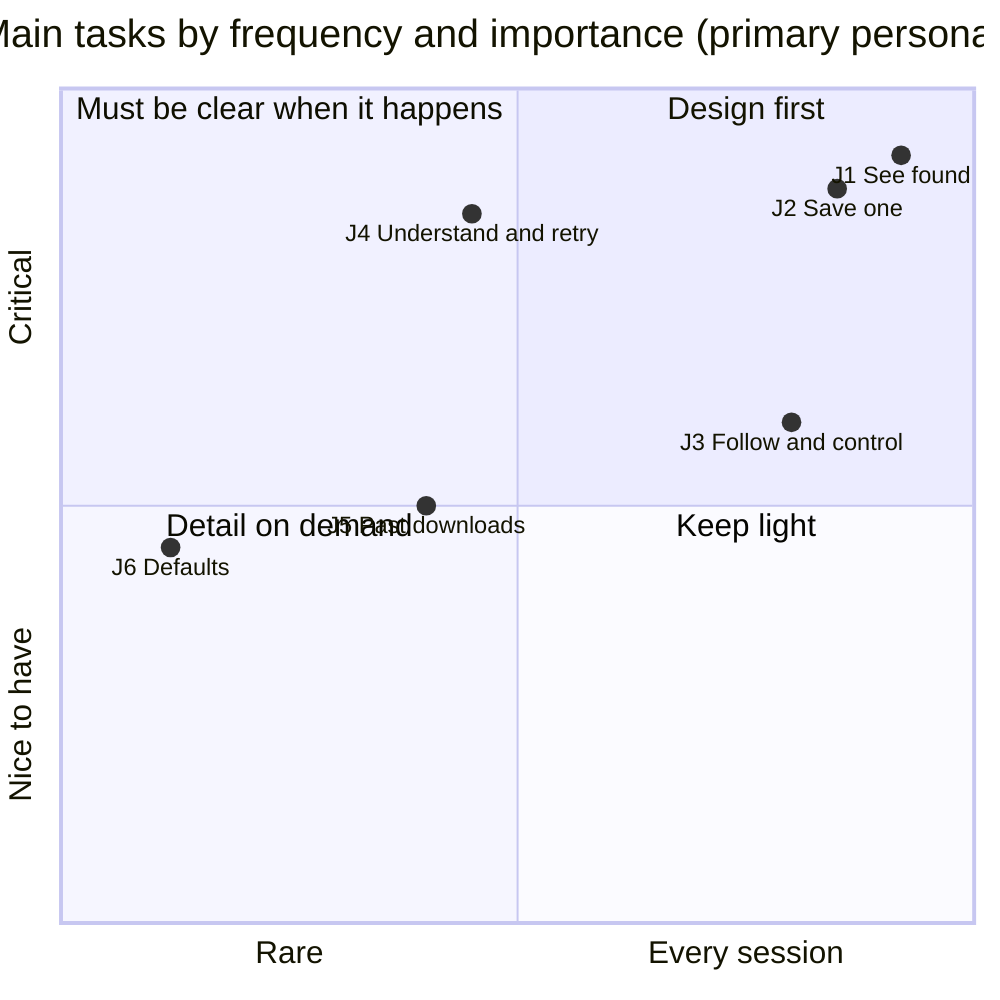

# Persona and main tasks

- Status: draft for D1 — Discovery
- Issue: #5
- Inputs: `docs/brief.md`, `references/design.md` §1

The yardstick for every later decision: who we design for, what they come to do, and how we know the design works. Concepts used here: [persona](../process.md#glossary), [jobs-to-be-done](../process.md#glossary), [progressive disclosure](../process.md#glossary).

These personas are **proto-personas**: assumptions drawn from the brief and the product rules, not from interviews. Servare sends no telemetry (design §1.2), so they will never be validated by usage data; they are checked in D8 through usability walkthroughs on the prototype.

## 1. Primary persona — Marina, the person who wants to keep a video

> "I just want to save this video so I can watch it later. Where is the button?"

| Aspect         | Description                                                                                                                                                                    |
| -------------- | ------------------------------------------------------------------------------------------------------------------------------------------------------------------------------ |
| Who            | 38, teacher. Uses the browser daily for work and leisure; installs an extension when a friend or a search result recommends it. Not technical.                                 |
| Vocabulary     | "video", "audio", "quality", "subtitles", "download", "file". Does not know what HLS, DASH, codec, bitrate or an HTTP status is, and should never need to.                     |
| Context of use | Laptop, sometimes a small screen. The video is playing (or just played) on a news site, course platform or public archive. Short attention window: a few seconds in the popup. |
| Devices        | Mouse or trackpad; occasionally keyboard only. May use OS zoom or a larger text size. Light or dark system theme.                                                              |
| Language       | Brazilian Portuguese first; English UI is acceptable but slower for her.                                                                                                       |

**Goals**

- Save the video she is watching, in one obvious action, with a sensible default quality.
- Know it worked and find the file afterwards.
- Sometimes keep only the audio (a lecture, a song) or include subtitles.

**Frustrations**

- A list of cryptic entries (`index.m3u8`, `seg-1.ts`, `1920x1080 4.5 Mbps avc1`) where she cannot tell which one is "the video".
- Silent failure: a bar that stops, or an error she cannot act on ("Error 403").
- Being blamed or lectured. If something cannot be saved, she wants a calm, honest reason and nothing more.
- Losing a download because she closed the popup or the browser paused the extension.

**What she needs from the UI**: one primary action per item, plain words, a clear "it's done" state, every error paired with a concrete next step. Technical detail stays behind an expandable control she never has to open.

## 2. Secondary persona — Rafael, the power user

> "Give me the 720p variant with the English audio track, the Portuguese subtitles, and name it the way I like."

| Aspect         | Description                                                                                                                          |
| -------------- | ------------------------------------------------------------------------------------------------------------------------------------ |
| Who            | 29, developer or video editor. Knows streaming formats, reads codec strings, often has developer tools open.                         |
| Context of use | Desktop, keyboard-heavy. Saves several items per session (a course, a series of talks, a live event), sometimes in a private window. |
| Language       | English or Portuguese; reads technical labels without trouble.                                                                       |

**Goals**

- Choose exactly the variant, audio tracks and subtitles; extract MP3 at a chosen quality.
- Queue many items and control them (pause, resume, cancel, stop a live recording and keep what was recorded).
- Set defaults once: file name template, subfolder, speed profile, MP3 quality, preferred languages, per-site rules.
- See the technical reason for a failure (HTTP status, incomplete ratio) to decide whether a retry is worth it.

**Frustrations**

- Tools that hide choices behind "smart" defaults with no way to override them.
- Having to repeat the same choices for every item.
- Vague errors with no detail.
- Anything that leaks data (telemetry, history entries from private windows).

**What he needs from the UI**: the same simple surface as Marina, plus detail on demand that is complete, fast to reach by keyboard and remembered through settings.

**Design rule.** When the two personas conflict, the default view serves Marina and the detail serves Rafael ([progressive disclosure](../process.md#glossary)). Rafael's needs never add steps to Marina's path.

## 3. Out of scope (anti-personas)

Servare is not designed for, and the UI never courts, people who want to:

- save from YouTube;
- save DRM-protected media or get past login, paywalls or captchas;
- record the screen.

Such media is shown as unavailable with a calm reason and never gets a download action (design §1.2, `CLAUDE.md`).

## 4. Main tasks as jobs-to-be-done

Each job follows the form _When … I want to … so I can …_. Frequency and importance are scored 1 (low) to 3 (high) for the primary persona; the rank is the product of both. Ties are broken by blocking first (a job that another job depends on ranks higher), then by frequency.

| Rank | Job (brief task)                   | Frequency | Importance | Score | Primary surface               |
| ---- | ---------------------------------- | --------- | ---------- | ----- | ----------------------------- |
| 1    | J1 — See what was found (task 1)   | 3         | 3          | 9     | Popup: media list             |
| 2    | J2 — Save one item (task 2)        | 3         | 3          | 9     | Popup: media list and choices |
| 3    | J3 — Follow and control (task 3)   | 3         | 2          | 6     | Popup: queue                  |
| 4    | J4 — Understand and retry (task 4) | 2         | 3          | 6     | Popup: queue                  |
| 5    | J5 — Find past downloads (task 5)  | 2         | 2          | 4     | History                       |
| 6    | J6 — Adjust defaults (task 6)      | 1         | 2          | 2     | Options page                  |

J1 ranks above J2 because saving depends on finding (blocking). Neither J3 nor J4 blocks the other, since both act on the same job in the queue, so frequency decides: every download is followed, while only some fail. J4 still has the higher importance, so its criteria are as strict.

### J1 — See what was found on this page

_When I am watching a video on a page, I want to see whether it can be saved, so I can decide in a glance._

- Data: `MediaItem` list (`media/list`), with `title`, `thumbnail?`, `duration`, `kind`, `protected` (contract §2.1, §4.1).
- Hard cases: no title, no thumbnail, unknown duration; live media; protected media; an empty list; the background reconnecting.

### J2 — Save one item

_When I found the video I want, I want to save it with good defaults, choosing quality, audio language, subtitles or audio only when I care, so I can keep it on my computer._

- Data and actions: `variants[]`, `audioTracks[]`, `subtitles[]`, `download/enqueue` with `variantId`, `audioTrackIds`, `subtitleIds`, `mode` (contract §2.1, §4.2).
- Default path: one action with the default variant and preferred languages; choices are detail on demand.

### J3 — Follow progress and control downloads

_When a download is running, I want to see that it advances and how long it will take, and to pause, resume, cancel, or stop a live recording keeping what was recorded, so I stay in control._

- Data and actions: `DownloadJob` `status`, `progress` (0–1 or indeterminate), `bytesWritten` (speed and ETA computed in the UI), `waiting`, `download/pause`, `resume`, `cancel`, `stop` (contract §2.2, §3, §4.2).

### J4 — Understand why something failed or is waiting, and retry

_When a download fails or waits, I want to know why in plain words and what to do next, so I can fix it or let it go._

- Data and actions: `DownloadError` kinds, `waiting.reason`, `download/retry` (contract §2.3, §3.2, §4.2). Technical detail (HTTP status, incomplete ratio, error message) only in an expandable part.

### J5 — Find past downloads

_When I want something I saved earlier, I want to find it by its name or page, so I can get to it again._

- Data and actions: `HistoryEntry` (`title`, `pageUrl`, `outputName`, `completedAt`, `bytes`, `status`), `history/list`, `remove`, `clear` (contract §4.3). Private-window jobs never appear.

### J6 — Adjust defaults

_When I keep making the same choices, I want to set them once, so every next download follows them._

- Data and actions: `Settings` (`nameTemplate`, `subfolder`, `speedProfile`, `mp3Quality`, `preferredLanguages`) and `DomainRule` via `rules/*` and `settings/*` (contract §4.4; options page, M5).

## 5. Success criteria per task

Every criterion is checked on the prototype (mock data) in D8, by a scripted walkthrough (Playwright) or a moderated usability session with at least five non-technical participants; usability thresholds are a share of participants (at least 80%). "Clicks" count pointer activations **after the popup is open**: opening the popup (toolbar button) is never counted. "Key presses" count from focus on the first element of the open popup. Labels are in the primary language only, with no technical term outside expandable detail (brief, _User_).

| Job | Criterion                                                                                                                                                                                                                                                                                                            | How it is measured                                       |
| --- | -------------------------------------------------------------------------------------------------------------------------------------------------------------------------------------------------------------------------------------------------------------------------------------------------------------------- | -------------------------------------------------------- |
| J1  | The popup shows the media list, or an empty state with a next step, in its first render; no extra click is needed to see what was found.                                                                                                                                                                             | Playwright: list or empty state visible on popup open    |
| J1  | Every item has a readable label, duration text and availability, including the "no title, no thumbnail, unknown duration" and live cases.                                                                                                                                                                            | State gallery: 100% of `MediaItem` fixtures labelled     |
| J1  | Protected items are recognisable as unavailable without opening anything, and have zero download controls.                                                                                                                                                                                                           | Playwright + axe: no download control on protected items |
| J1  | At least 80% of participants identify the item they were watching in 10 seconds or less on a page with 3 items.                                                                                                                                                                                                      | Usability session                                        |
| J2  | With one available item, saving it with defaults takes **at most 1 click** (save).                                                                                                                                                                                                                                   | Playwright click count                                   |
| J2  | With several items, saving one with defaults takes at most 2 clicks (pick the item, save).                                                                                                                                                                                                                           | Playwright click count                                   |
| J2  | Choosing a quality, an audio language, subtitles or audio only (MP3) takes at most 2 extra clicks each, and the default choice is visible before saving.                                                                                                                                                             | Playwright click count                                   |
| J2  | The whole save path, including choices, is keyboard operable in at most 8 key presses for the default save and with visible focus at every step.                                                                                                                                                                     | Playwright keyboard script                               |
| J2  | Every quality, audio and subtitle option has a human label even when `width`, `height`, `language` or `label` are missing (fallback labels).                                                                                                                                                                         | State gallery: fixtures with missing optional fields     |
| J3  | Feedback that the download started appears within 1 second of the save action, in the same view.                                                                                                                                                                                                                     | Playwright timing on mock client                         |
| J3  | Progress shows a percentage or, when `progress` is indeterminate, a moving or textual indicator plus bytes written; speed and ETA appear once they can be computed.                                                                                                                                                  | State gallery: running, indeterminate, live              |
| J3  | Pause, resume, cancel and stop (live) are each reachable in 1 click from the job and announced to screen readers when the status changes.                                                                                                                                                                            | Playwright + axe; live-region check                      |
| J3  | Cancelling a running job asks for confirmation (the contract has no undo: `cancel` discards); stopping a live recording states that the recorded part is kept.                                                                                                                                                       | Copy review; usability session                           |
| J3  | After the background reconnects, the queue shows the same jobs and states without user action; a "reconnecting" state is visible while it happens.                                                                                                                                                                   | Mock client: forced disconnect                           |
| J4  | Every `DownloadError` kind and `waiting.reason` has a primary message in plain words, followed by one concrete action where the contract lists one; `protected` and `cancelled` get a calm explanation and no action (protected media never gets a retry or download action). 100% coverage, unknown kinds included. | State catalog vs. contract §2.3, §3.2                    |
| J4  | Every `MessagingError` code the UI shows (contract §1 table: generic error for `invalid-message`, `invalid-payload`, `invalid-response`; `handler-failed` notice; `disconnected` and `timeout` with reconnect and retry) has a plain-words message; `unknown-request` hides or disables the feature instead.         | State catalog vs. contract §1                            |
| J4  | Retry is reachable in 1 click from a failed job when the error allows it.                                                                                                                                                                                                                                            | Playwright click count                                   |
| J4  | Technical detail (HTTP status, incomplete ratio, raw message) is available in an expandable part and absent from the primary text.                                                                                                                                                                                   | Copy review                                              |
| J4  | At least 80% of participants can say, in their own words, what to do next after reading an `http` 403 error.                                                                                                                                                                                                         | Usability session                                        |
| J5  | History is reachable in at most 2 clicks from the open popup.                                                                                                                                                                                                                                                        | Playwright click count                                   |
| J5  | A past download is found by typing part of its title, file name or page in at most 10 seconds on a list of 50 entries.                                                                                                                                                                                               | Usability session; filter over `history/list` result     |
| J5  | Removing one entry takes at most 2 clicks; clearing all asks for confirmation.                                                                                                                                                                                                                                       | Playwright click count                                   |
| J6  | Each setting is reachable in at most 3 clicks from the open popup, has a plain label and an example of its effect (e.g. the resulting file name for the template).                                                                                                                                                   | Playwright click count; copy review                      |
| J6  | Invalid values show the problem next to the field, using the issue paths returned by `invalid-payload`, before or on save.                                                                                                                                                                                           | Mock client: `invalid-payload` fixture                   |
| J6  | Marina never has to visit the options page to complete J1–J5.                                                                                                                                                                                                                                                        | Walkthrough of J1–J5 with default settings               |

**Cross-cutting criteria** (apply to every job): WCAG 2.2 AA (axe: zero violations), full keyboard operation, layouts hold at 380px width with strings 40% longer than English (pseudo-locale), light and dark themes, and zero network requests from the prototype.

## 6. Coverage check

| Brief task                                                                                             | Job | Rank | Criteria |
| ------------------------------------------------------------------------------------------------------ | --- | ---- | -------- |
| 1. See what was found on this page                                                                     | J1  | 1    | 4        |
| 2. Save one item, optionally choosing quality, audio language and subtitles, or audio only (MP3)       | J2  | 2    | 5        |
| 3. Follow progress; pause, resume, cancel; stop a live recording and keep what was recorded            | J3  | 3    | 5        |
| 4. Understand why something failed or is waiting, and retry                                            | J4  | 4    | 5        |
| 5. Find past downloads (history)                                                                       | J5  | 5    | 3        |
| 6. Adjust defaults: file name template, subfolder, speed, MP3 quality, preferred languages, site rules | J6  | 6    | 3        |

## 7. Contract gaps found

Recorded in [`contract-gaps.md`](contract-gaps.md): opening a finished file or its folder (J5, J3), the failure reason of a history entry (J4, J5), and history paging or search (J5).
