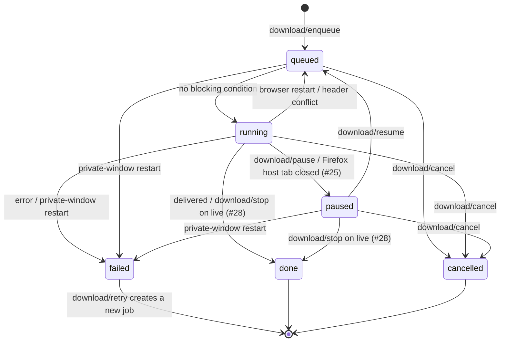

# State inventory

- Status: draft for D1 — Discovery
- Issue: #6
- Inputs: `docs/brief.md`, `references/ui-contract.md` §1, §2.1–2.3, §3, §6, §7

Every state the UI can be in, listed before anything is drawn so the design covers more than the happy path. This is [contract-first design](../process.md#glossary): each row is derived from a field, value or request in `references/ui-contract.md`, never from what we would like the background to say. "What the user needs to know" is written for Marina ([persona](persona.md)); technical detail is [progressive disclosure](../process.md#glossary) material and is marked _Details_.

The IDs are **stable**: the state gallery, the spec (`docs/spec/`) and later issues refer to them. Do not rename an ID; deprecate it and add a new one.

## How to read this

- **Primary rows** own one contract value each (a `status`, an error `kind`, a failure `code`). Each such value is owned by exactly one primary row; see [§7 Coverage check](#7-coverage-check).
- **Variant rows** refine a primary row (live, waiting, `401/403`, …). They never introduce a value the contract does not have.
- **Allowed actions** for jobs are only the triggers of the §3.1 transition table: `download/enqueue`, `download/pause`, `download/resume`, `download/cancel`, `download/stop`, plus `download/retry`, which §3.1 defines for `failed` ("creates a new job from the same parameters"). Removing a finished job from the list is not a status transition and is left to the flows.
- "Planned (#N)" means the background answers `unknown-request` until that issue lands: see [`NET-UNKNOWN-REQUEST`](#5-transport-and-availability).

## 1. Media item (`MediaItem`, §2.1, §6)

The item card is built from independent facets. The gallery renders each facet row on its own and the composite cases in §1.2.

**Validity constraints** (combinations that cannot occur, so they are not designed):

- `kind: 'direct'` ⇒ `variants` is empty (no quality choice).
- `duration: 'live'` ⇒ `kind: 'hls'` (the contract defines live only for HLS).
- `protected: true` overrides every other facet: the item is shown, but with no options and no action.

The only action on a media item is **Download** → `download/enqueue` (_(new)_ → `queued`), with optional `variantId`, `audioTrackIds`, `subtitleIds` and `mode` (`'video'` default, `'audio'` = MP3, M4). Before M2 `download/enqueue` is not available (§7: M1 uses a dev-only path); the button follows `NET-UNKNOWN-REQUEST`.

### 1.1 Facets

| ID                        | Condition (contract fields)                                                  | What the user needs to know                                                                                                                        | Allowed actions                                                      |
| ------------------------- | ---------------------------------------------------------------------------- | -------------------------------------------------------------------------------------------------------------------------------------------------- | -------------------------------------------------------------------- |
| `MEDIA-TITLE-PRESENT`     | `title` non-empty (≤ 1024 chars)                                             | Which video this is. Long titles are truncated visually with the full title available (tooltip / accessible name).                                 | Download                                                             |
| `MEDIA-TITLE-EMPTY`       | `title === ''`                                                               | Still which one it is: a fallback label (e.g. "Video 1" from list order, or the page's host from `pageUrl`), never the raw `url`.                  | Download                                                             |
| `MEDIA-THUMB-PRESENT`     | `thumbnail` set (http(s) or `data:image/…`)                                  | A picture that helps recognize the video. If the image fails to load, fall back to `MEDIA-THUMB-MISSING`.                                          | Download                                                             |
| `MEDIA-THUMB-MISSING`     | `thumbnail` absent                                                           | Nothing is wrong: a neutral local placeholder (video or audio glyph), no broken image.                                                             | Download                                                             |
| `MEDIA-DURATION-KNOWN`    | `duration > 0`                                                               | How long it is (e.g. "30:34").                                                                                                                     | Download                                                             |
| `MEDIA-DURATION-UNKNOWN`  | `duration === 0`                                                             | Nothing; omit the duration rather than show "0:00".                                                                                                | Download                                                             |
| `MEDIA-LIVE`              | `duration === 'live'` (HLS)                                                  | It is a live broadcast: downloading means **recording** from now until they stop, and they keep what was recorded.                                 | Download (starts a recording; stop later with `download/stop`, M4)   |
| `MEDIA-DIRECT`            | `kind: 'direct'`, `variants` empty                                           | One file, no quality to choose. _Details_: "Direct file".                                                                                          | Download                                                             |
| `MEDIA-VARIANTS`          | `variants.length ≥ 1`                                                        | Quality choices in plain words ("1080p", "720p"), a sensible default preselected. _Details_: resolution, bitrate, codecs, `container`, `kind`.     | Download, optionally with `variantId`                                |
| `MEDIA-VARIANTS-PENDING`  | `kind: 'hls' \| 'dash'`, `variants` empty (manifest not parsed yet)          | Quality options may still appear. Whether the default quality can be downloaded before the manifest is parsed is unconfirmed (see §8).             | Download (default variant)                                           |
| `MEDIA-VARIANT-UNLABELED` | A `Variant` without `width`/`height` (and possibly `bandwidth`)              | A neutral fallback label ("Option 2") so every choice is still distinguishable.                                                                    | Download, optionally with `variantId`                                |
| `MEDIA-AUDIO-TRACKS`      | `audioTracks.length ≥ 1`                                                     | Which audio languages are available, by name ("Português"). Can arrive later via `tracks/updated`; the list updates in place without moving focus. | Download, optionally with `audioTrackIds`                            |
| `MEDIA-SUBTITLES`         | `subtitles.length ≥ 1`                                                       | Which subtitle languages are available.                                                                                                            | Download, optionally with `subtitleIds` (M4)                         |
| `MEDIA-TRACK-UNLABELED`   | A `Track` without `label` and/or `language`                                  | Name from `language` (localized language name) when only that exists; otherwise a fallback ("Audio 2", "Subtitles 2").                             | As the parent facet                                                  |
| `MEDIA-NO-TRACKS`         | `audioTracks` and `subtitles` empty                                          | Nothing; no empty "Audio" or "Subtitles" controls.                                                                                                 | Download                                                             |
| `MEDIA-AUDIO-ONLY`        | Item is not protected (`mode: 'audio'` is a choice, not a field of the item) | They can keep just the sound as an MP3.                                                                                                            | Download with `mode: 'audio'` (M4)                                   |
| `MEDIA-PROTECTED`         | `protected: true` (§6)                                                       | Calmly: this video is protected and Servare does not save protected content. No blame, no workaround.                                              | None. Never a download control; `download/enqueue` would fail anyway |

### 1.2 Composite cases for the gallery

| ID                     | Combination                                                                        | Why it is designed                                                         |
| ---------------------- | ---------------------------------------------------------------------------------- | -------------------------------------------------------------------------- |
| `MEDIA-BARE`           | `direct`, `title` empty, no `thumbnail`, `duration: 0`, no tracks                  | The worst-information case the brief requires; must still be recognizable. |
| `MEDIA-RICH`           | `hls`, title, thumbnail, known duration, several variants, audio tracks, subtitles | The densest card; checks the 380px layout and +40% text.                   |
| `MEDIA-DASH-SPLIT`     | `dash`, variants + separate audio tracks (M3)                                      | Video and audio choices that are combined into one file.                   |
| `MEDIA-LIVE-BARE`      | `hls`, `duration: 'live'`, title empty, no thumbnail, variants pending             | A live stream with minimal information.                                    |
| `MEDIA-PROTECTED-RICH` | `protected: true` with title and thumbnail                                         | Shows that protection, not missing data, is why there is no action.        |
| `MEDIA-LONG-LIST`      | Many items in one tab (ordered oldest first, §4.1)                                 | Scanning a long list; which one is "the video".                            |

## 2. Download job (`DownloadJob`, §2.2, §3)

A job's display title and picture come from its `mediaId`; the job itself only has `outputName`. See `JOB-MEDIA-GONE`.

### 2.1 Statuses

| ID              | Status      | What the user needs to know                                                                                                                      | Allowed actions (§3.1)                                                          |
| --------------- | ----------- | ------------------------------------------------------------------------------------------------------------------------------------------------ | ------------------------------------------------------------------------------- |
| `JOB-QUEUED`    | `queued`    | It is accepted and will start by itself; nothing to do. After a browser restart a job returns here and continues on its own.                     | Cancel (`download/cancel` → `cancelled`)                                        |
| `JOB-RUNNING`   | `running`   | It is saving: how far along, how fast, about how long is left. It keeps going if the popup is closed.                                            | Pause (`download/pause` → `paused`), Cancel (`download/cancel` → `cancelled`)   |
| `JOB-PAUSED`    | `paused`    | It is stopped, progress is kept, and it will **not** continue until they resume (also when the pause came from closing the host tab on Firefox). | Resume (`download/resume` → `queued`), Cancel (`download/cancel` → `cancelled`) |
| `JOB-DONE`      | `done`      | It worked; the file name (`outputName`) and where it went, in plain words (see gap G1 fallback).                                                 | None (terminal)                                                                 |
| `JOB-FAILED`    | `failed`    | It did not finish, why, and what to do next: rendered with the matching `ERR-*` row (§3).                                                        | Retry (`download/retry`, new job), unless the error row says otherwise          |
| `JOB-CANCELLED` | `cancelled` | It was stopped at their request and the partial file was deleted. Rendered with `ERR-CANCELLED`.                                                 | None (terminal)                                                                 |

### 2.2 Variants

| ID                          | Condition                                                                                  | What the user needs to know                                                                                                                                                                   | Allowed actions (§3.1)                                                                                                                                     |
| --------------------------- | ------------------------------------------------------------------------------------------ | --------------------------------------------------------------------------------------------------------------------------------------------------------------------------------------------- | ---------------------------------------------------------------------------------------------------------------------------------------------------------- |
| `JOB-QUEUED-WAITING`        | `queued` with `waiting.reason: 'header-conflict'` and `blockingJobId` (planned, #25; §3.2) | It is waiting for another download from the same site to finish, and which one (resolve `blockingJobId` in `download/list`). They can wait, or end the other one. _Details_: header conflict. | Cancel this job. On the blocking job: `download/stop` if it is a live recording (keeps what was recorded), otherwise `download/pause` or `download/cancel` |
| `JOB-RUNNING-STARTING`      | `running`, `bytesWritten === 0` (any `progress`)                                           | It is starting; no speed or time estimate yet.                                                                                                                                                | As `JOB-RUNNING`                                                                                                                                           |
| `JOB-RUNNING-DETERMINATE`   | `running`, `progress` a number in 0–1                                                      | Percentage, speed and time left (both computed by the UI from `bytesWritten` over time, §3.3). Progress never goes backwards within a run.                                                    | As `JOB-RUNNING`                                                                                                                                           |
| `JOB-RUNNING-INDETERMINATE` | `running`, `progress: 'indeterminate'`, media not live                                     | The total size is unknown: show amount saved and speed, no percentage, no time left.                                                                                                          | As `JOB-RUNNING`                                                                                                                                           |
| `JOB-RUNNING-LIVE`          | `running`, `progress: 'indeterminate'`, media `duration: 'live'` (M4)                      | It is **recording** a live broadcast; how much has been recorded (`bytesWritten`). Stopping keeps the recording; cancelling throws it away. The two must not be confused.                     | Stop (`download/stop` → `done`, #28), Pause (`download/pause` → `paused`), Cancel (`download/cancel` → `cancelled`)                                        |
| `JOB-PAUSED-LIVE`           | `paused`, media `duration: 'live'` (M4)                                                    | The recording is paused; they can keep what was recorded now or continue.                                                                                                                     | Stop (`download/stop` → `done`, #28), Resume (`download/resume` → `queued`), Cancel (`download/cancel` → `cancelled`)                                      |
| `JOB-PAUSED-RESUMED`        | `paused` → `queued` → `running`; `progress` restarts from the persisted value (§3.3)       | It continues from where it stopped, not from zero.                                                                                                                                            | As the current status                                                                                                                                      |
| `JOB-AUDIO-MODE`            | `mode: 'audio'` (MP3, M4), any status                                                      | It is saving only the sound as MP3 (shown as a small label on the job).                                                                                                                       | As the current status                                                                                                                                      |
| `JOB-MEDIA-GONE`            | Any status; `mediaId` not found in `media/list` (tab navigated)                            | Still which download it is: title from `outputName`, placeholder picture. Nothing is wrong.                                                                                                   | As the current status                                                                                                                                      |

## 3. Job errors (`DownloadError`, §2.3, §3.1, §6)

`error` is present only when `status` is `failed` or `cancelled`. A `kind` the UI does not recognize is rendered as `ERR-UNKNOWN`. _Details_ may show the raw `kind`, `status` code or `message`.

### 3.1 Kinds

| ID               | `kind`       | What the user needs to know                                                                                                     | Allowed actions (§3.1)                                                          |
| ---------------- | ------------ | ------------------------------------------------------------------------------------------------------------------------------- | ------------------------------------------------------------------------------- |
| `ERR-CANCELLED`  | `cancelled`  | They stopped it; nothing else to do. Appears with `JOB-CANCELLED`, not as an error tone.                                        | None (terminal)                                                                 |
| `ERR-HTTP`       | `http`       | The site refused or stopped sending the video. Rendered as one of the variants below, chosen by `status`.                       | See variants                                                                    |
| `ERR-INCOMPLETE` | `incomplete` | Only part of the video arrived: "about N% was received" (`ratio` × 100, rounded down). Trying again often works.                | Retry (`download/retry`)                                                        |
| `ERR-DECRYPT`    | `decrypt`    | The video could not be read this time (a piece needed to read it was not available). Trying again may work. _Details_: AES-128. | Retry (`download/retry`)                                                        |
| `ERR-QUOTA`      | `quota`      | The computer is out of space for the temporary file; free some disk space, then try again.                                      | Retry (`download/retry`) after freeing space                                    |
| `ERR-PROTECTED`  | `protected`  | Same message as `MEDIA-PROTECTED`: protection was found after it started; Servare does not save protected content.              | **None.** Retry is withheld by product policy (§6), although `failed` allows it |
| `ERR-UNKNOWN`    | `unknown`    | Something unexpected happened; show `message` as given, and offer to try again. Also the fallback for unrecognized kinds.       | Retry (`download/retry`)                                                        |

### 3.2 Variants

| ID                            | Condition                                                                                                    | What the user needs to know                                                                                                                                                                                                                    | Allowed actions (§3.1)                            |
| ----------------------------- | ------------------------------------------------------------------------------------------------------------ | ---------------------------------------------------------------------------------------------------------------------------------------------------------------------------------------------------------------------------------------------- | ------------------------------------------------- |
| `ERR-HTTP-AUTH`               | `kind: 'http'`, `status` 401 or 403                                                                          | The site stopped allowing this download: open the page, play the video once, then try again. _Details_: the code.                                                                                                                              | Retry (`download/retry`) after reopening the page |
| `ERR-HTTP-OTHER`              | `kind: 'http'`, any other `status` (e.g. 404, 5xx)                                                           | The site did not send the video; it may be temporary, or the link may have expired. Try again, or reopen the page first. _Details_: the code.                                                                                                  | Retry (`download/retry`)                          |
| `ERR-UNKNOWN-PRIVATE-RESTART` | `kind: 'unknown'` on a private-window job that was `queued`, `running` or `paused` at browser restart (§3.1) | Private downloads cannot survive a browser restart; reopen the page to start again. Retry may fail with `handler-failed` (`NET-HANDLER-FAILED`) because the `mediaId` is probably gone. Renders as `ERR-UNKNOWN` until G5 makes it detectable. | Retry (`download/retry`)                          |
| `ERR-UNKNOWN-HOST-TAB`        | `kind: 'unknown'` on Firefox when the host tab closed, until #25 turns this into `JOB-PAUSED` (§3.1)         | The tab that was playing the video was closed, which stopped the download; reopen it and try again. Only `message` says so (gap G5).                                                                                                           | Retry (`download/retry`)                          |

## 4. Page-level states (popup body for the current tab, §4.1, §7)

| ID                    | Condition                                                                           | What the user needs to know                                                                                                     | Allowed actions                            |
| --------------------- | ----------------------------------------------------------------------------------- | ------------------------------------------------------------------------------------------------------------------------------- | ------------------------------------------ |
| `PAGE-LOADING`        | `media/list` in flight (first open or re-fetch after reconnect)                     | Nothing yet; a brief, non-blocking placeholder (no spinner flash for fast answers).                                             | None                                       |
| `PAGE-EMPTY`          | `media/list` answers `[]`                                                           | Nothing found yet; play the video on the page and it will appear here. Some pages cannot be read (gap G8).                      | Scan this page (`media/scan`, planned #31) |
| `PAGE-LIST`           | `media/list` answers ≥ 1 item; kept current by `media/updated`                      | What was found, newest additions appearing without moving focus.                                                                | Per item (§1)                              |
| `PAGE-ALL-PROTECTED`  | Every item has `protected: true`                                                    | Everything on this page is protected; there is nothing Servare can save here.                                                   | None                                       |
| `PAGE-SCANNING`       | `media/scan` in flight                                                              | It is looking; the button is busy and not pressable twice.                                                                      | None                                       |
| `PAGE-SCAN-FOUND`     | `media/scan` → `found > 0`, `blobOnly: false`; items arrive through `media/updated` | How many were found; they are in the list.                                                                                      | Per item (§1)                              |
| `PAGE-SCAN-NONE`      | `media/scan` → `found: 0`, `blobOnly: false`                                        | Still nothing; play the video first, then scan again.                                                                           | Scan again                                 |
| `PAGE-SCAN-BLOB-ONLY` | `media/scan` → `blobOnly: true`                                                     | This page plays video in a way Servare cannot capture on its own. Calm and honest; no workaround. _Details_: MSE / `blob:` URL. | None                                       |
| `PAGE-QUEUE`          | `download/list` returns jobs (any tab)                                              | Downloads in progress and recently finished, each as §2.                                                                        | Per job (§2)                               |
| `PAGE-QUEUE-EMPTY`    | `download/list` returns `[]`                                                        | Nothing is downloading; the queue area collapses rather than showing an empty box.                                              | None                                       |

## 5. Transport and availability (§1)

Request failures are `MessagingError`s and are **not** job failures (those are §3). Automatic retry is allowed only for idempotent requests (`*/list`, `*/get`, `download/pause`, `download/resume`, `download/cancel`, `download/stop`, `download/remove`); after a failed `download/enqueue` or `download/retry`, re-fetch `download/list` and offer the action again only if no matching new job appeared.

### 5.1 Connection

| ID                 | Condition                                                              | What the user needs to know                                                                                       | Allowed actions |
| ------------------ | ---------------------------------------------------------------------- | ----------------------------------------------------------------------------------------------------------------- | --------------- |
| `NET-CONNECTED`    | Port open                                                              | Nothing; no indicator.                                                                                            | All             |
| `NET-RECONNECTING` | Port disconnected; `PortClient` reconnecting with backoff              | A discreet "reconnecting" note; the last known lists stay visible but job controls are disabled until re-fetched. | None until back |
| `NET-REFETCHING`   | `onReconnect` fired; `media/list` and `download/list` being re-fetched | Nothing beyond `PAGE-LOADING` in place; the note disappears when the lists arrive.                                | None until done |

### 5.2 Request failure codes

| ID                     | `code`             | What the user needs to know                                                                                                                 | UI behavior                                                                                  |
| ---------------------- | ------------------ | ------------------------------------------------------------------------------------------------------------------------------------------- | -------------------------------------------------------------------------------------------- |
| `NET-INVALID-MESSAGE`  | `invalid-message`  | Something went wrong in Servare; try again. _Details_: the code.                                                                            | Generic error notice (a bug)                                                                 |
| `NET-UNKNOWN-REQUEST`  | `unknown-request`  | Nothing: the feature is not available yet.                                                                                                  | Hide or disable the control (e.g. scan #31, stop #28, waiting reason #25, enqueue before M2) |
| `NET-INVALID-PAYLOAD`  | `invalid-payload`  | Same as `NET-INVALID-MESSAGE`.                                                                                                              | Generic error notice (a bug)                                                                 |
| `NET-INVALID-RESPONSE` | `invalid-response` | Same as `NET-INVALID-MESSAGE`.                                                                                                              | Generic error notice (a bug)                                                                 |
| `NET-HANDLER-FAILED`   | `handler-failed`   | The reason in `message`, as a notice. Also what `download/enqueue` returns for a protected item (should not happen: no control is offered). | Show `message` as a notice                                                                   |
| `NET-DISCONNECTED`     | `disconnected`     | Usually nothing: it is retried once when safe. If not safe, the list is refreshed before offering the action again.                         | Retry once if idempotent; otherwise re-fetch first                                           |
| `NET-TIMEOUT`          | `timeout`          | Servare did not answer in time; offer to try again.                                                                                         | Reconnect, re-fetch, then offer retry                                                        |

## 6. Gaps found

Recorded in [`contract-gaps.md`](contract-gaps.md). Each state above that depends on them uses the listed fallback until the contract changes.

| Gap | Affects                                                                                              |
| --- | ---------------------------------------------------------------------------------------------------- |
| G1  | `JOB-DONE` (open or show the file)                                                                   |
| G4  | `JOB-RUNNING-LIVE`, `JOB-PAUSED-LIVE` with `JOB-MEDIA-GONE`                                          |
| G5  | `ERR-UNKNOWN-PRIVATE-RESTART`, `ERR-UNKNOWN-HOST-TAB`, `NET-HANDLER-FAILED` (untranslated `message`) |
| G6  | `JOB-PAUSED` (user pause vs host tab closed)                                                         |
| G7  | `JOB-FAILED` (is anything left on disk?)                                                             |
| G8  | `PAGE-EMPTY` (why nothing was found)                                                                 |
| G9  | `MEDIA-DIRECT`, `JOB-RUNNING-DETERMINATE` (size)                                                     |
| G10 | `MEDIA-VARIANTS`, `MEDIA-VARIANT-UNLABELED` (size per quality)                                       |
| G11 | `JOB-MEDIA-GONE`                                                                                     |
| G14 | `PAGE-QUEUE` (order, timestamps)                                                                     |
| G15 | `MEDIA-VARIANTS-PENDING`                                                                             |
| G16 | §8 open questions                                                                                    |

## 7. Coverage check

Each contract value and its single owning row.

| Contract value                   | Owning ID              |
| -------------------------------- | ---------------------- |
| status `queued`                  | `JOB-QUEUED`           |
| status `running`                 | `JOB-RUNNING`          |
| status `paused`                  | `JOB-PAUSED`           |
| status `done`                    | `JOB-DONE`             |
| status `failed`                  | `JOB-FAILED`           |
| status `cancelled`               | `JOB-CANCELLED`        |
| waiting reason `header-conflict` | `JOB-QUEUED-WAITING`   |
| error kind `cancelled`           | `ERR-CANCELLED`        |
| error kind `http`                | `ERR-HTTP`             |
| error kind `incomplete`          | `ERR-INCOMPLETE`       |
| error kind `decrypt`             | `ERR-DECRYPT`          |
| error kind `quota`               | `ERR-QUOTA`            |
| error kind `protected`           | `ERR-PROTECTED`        |
| error kind `unknown`             | `ERR-UNKNOWN`          |
| failure code `invalid-message`   | `NET-INVALID-MESSAGE`  |
| failure code `unknown-request`   | `NET-UNKNOWN-REQUEST`  |
| failure code `invalid-payload`   | `NET-INVALID-PAYLOAD`  |
| failure code `invalid-response`  | `NET-INVALID-RESPONSE` |
| failure code `handler-failed`    | `NET-HANDLER-FAILED`   |
| failure code `disconnected`      | `NET-DISCONNECTED`     |
| failure code `timeout`           | `NET-TIMEOUT`          |
| `media/scan` `blobOnly: true`    | `PAGE-SCAN-BLOB-ONLY`  |
| `MediaItem.protected: true`      | `MEDIA-PROTECTED`      |

Every action in §2 and §3 is a §3.1 trigger: `download/enqueue` (new → `queued`), `download/cancel` (`queued`/`running`/`paused` → `cancelled`), `download/pause` (`running` → `paused`), `download/resume` (`paused` → `queued`), `download/stop` (`running`/`paused` → `done`, live only), `download/retry` (`failed` → new job).

## 8. Open questions

- Can a live job be extracted as MP3 (`mode: 'audio'` with `duration: 'live'`)? The contract neither allows nor forbids it (G16).
- Does `PortClient` ever give up reconnecting? If so, `NET-RECONNECTING` needs a terminal "could not reconnect" state; the contract only says "with backoff" (G16).
- What does `download/stop` do on a job that is not live? The UI never offers it there, but `JOB-MEDIA-GONE` can hide whether a job is live (G4, G16).
- Can an HLS/DASH item be downloaded at the default quality before its manifest is parsed (`MEDIA-VARIANTS-PENDING`)? The contract defines a missing `variantId` as default only for direct files and audio-only (G15).
