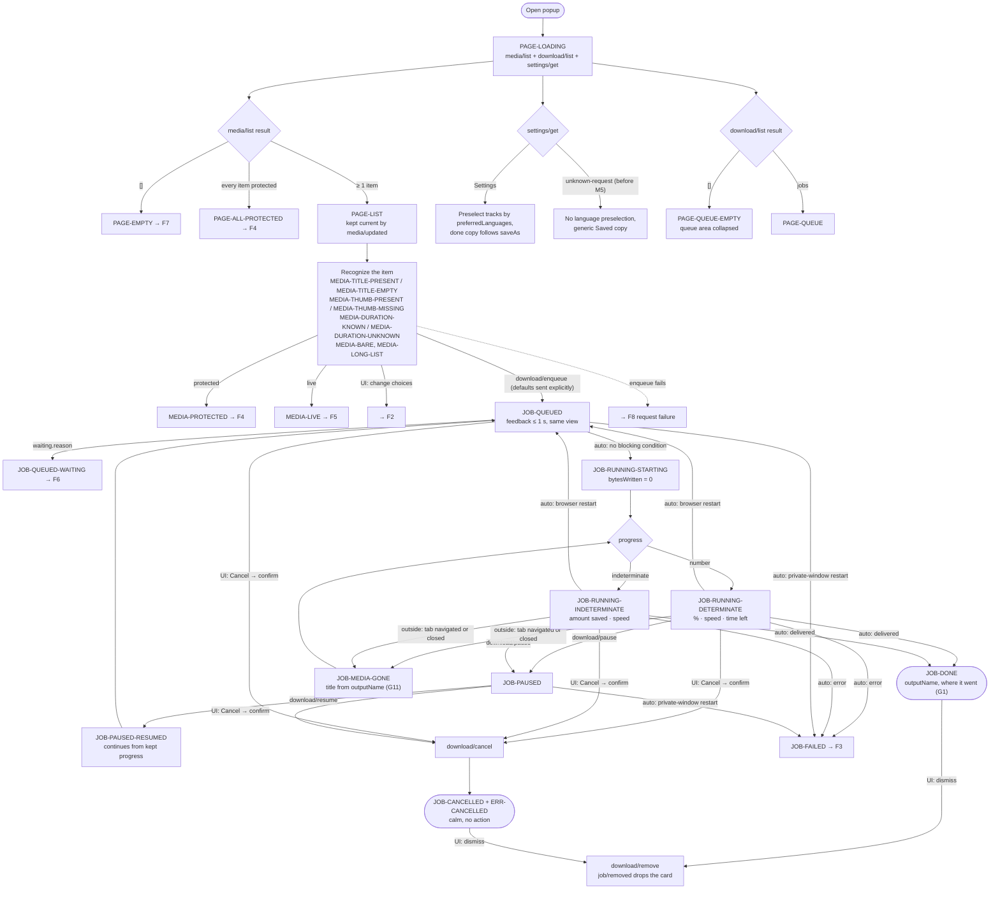
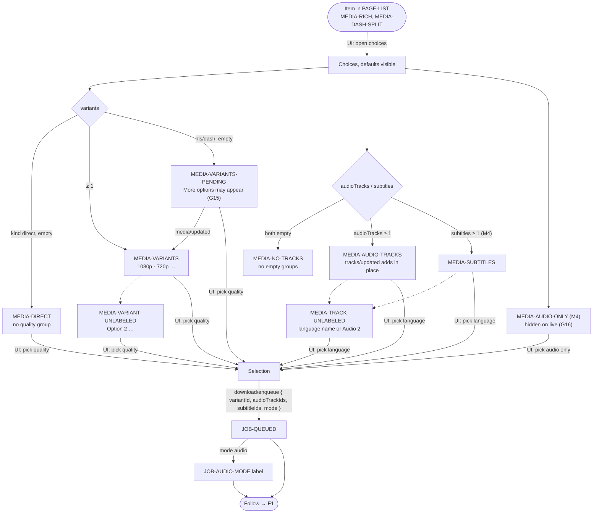
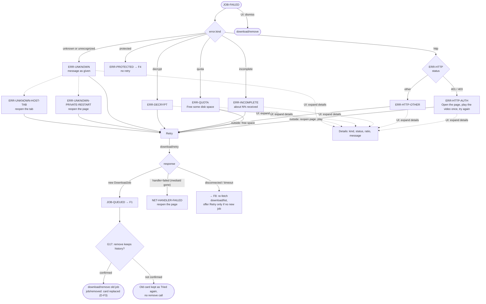
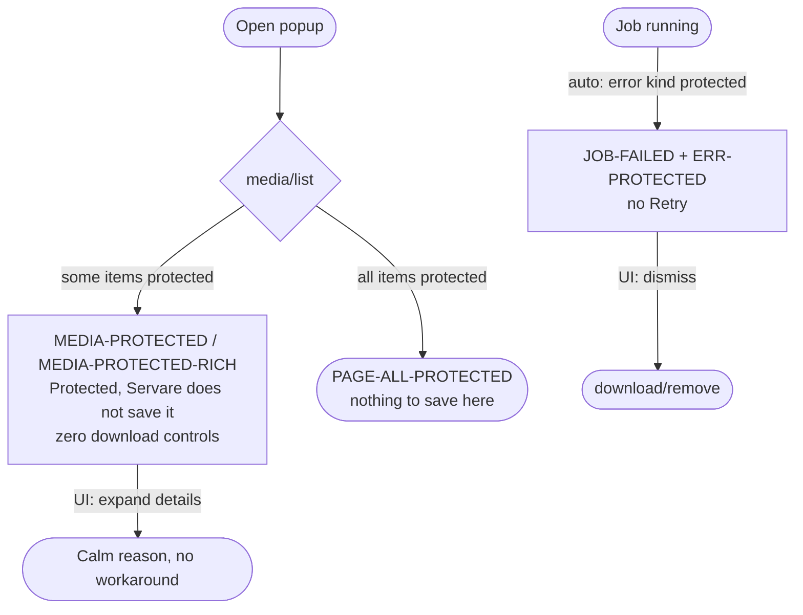
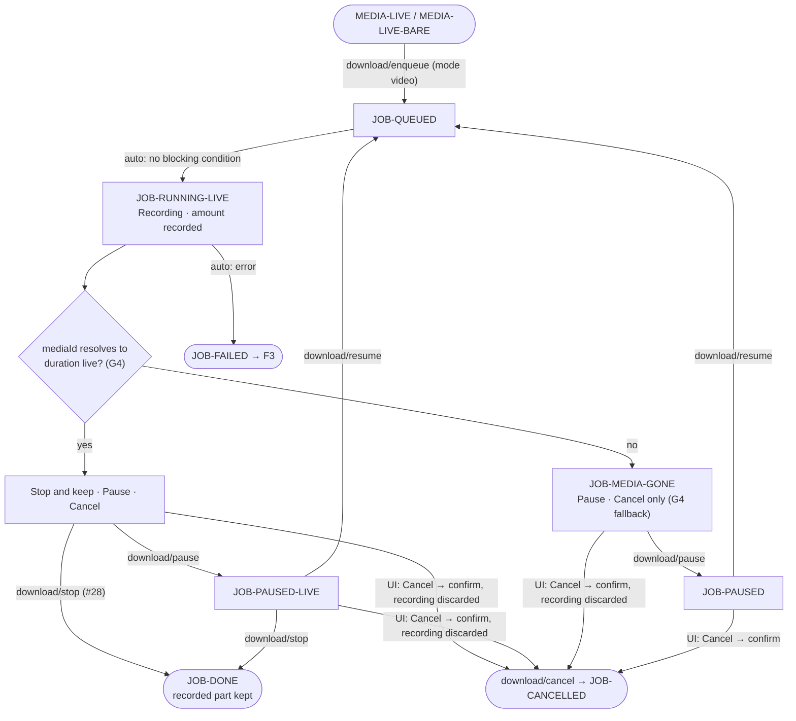
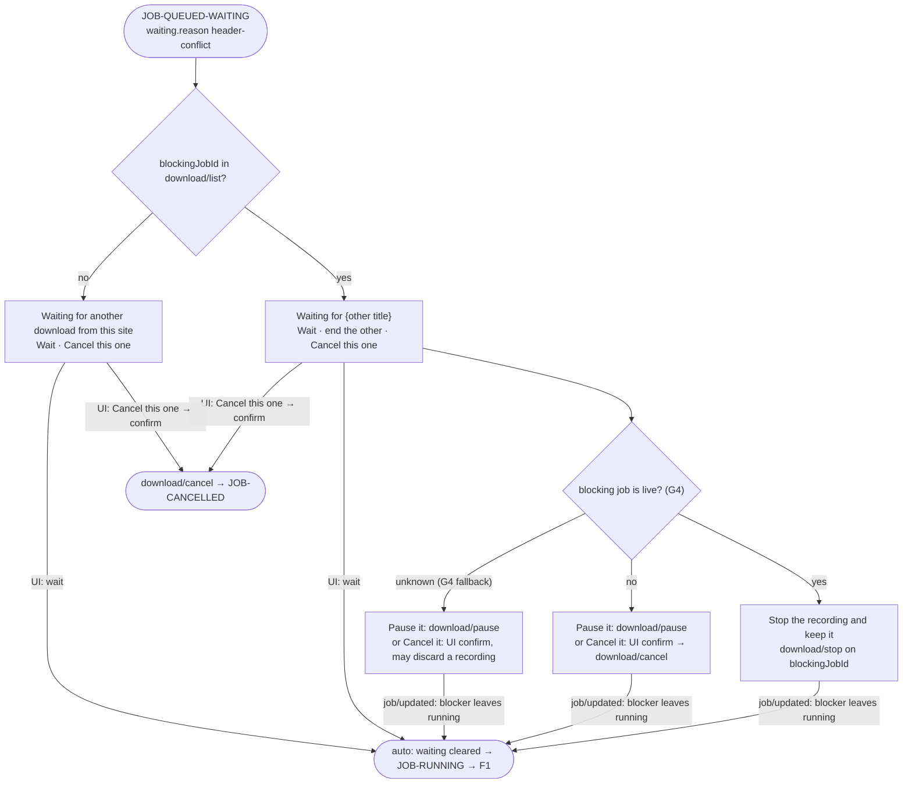
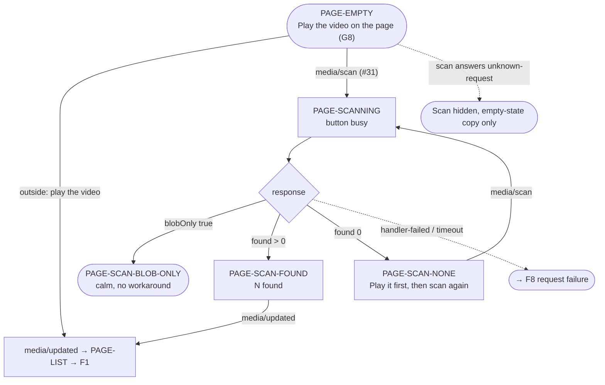
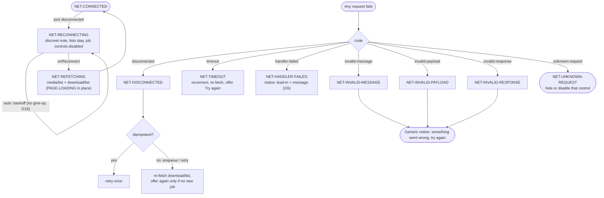

# Core user flows

- Status: draft for D2 — Flows & IA
- Issue: #8
- Inputs: `docs/brief.md`, `docs/discovery/persona.md`, `docs/discovery/state-inventory.md`, `references/ui-contract.md` §3.1

How the user moves through the eight core tasks, unhappy paths included, before any screen is decided. Flows are [contract-first](../process.md#glossary): every edge is a contract request or event, a transition from §3.1, or a UI-only interaction that sends nothing. Every box names the [state inventory](../discovery/state-inventory.md) ID it renders. Layout (where the list, choices and queue sit) is decided later in D2; this document only fixes what each flow needs from it ([Flow decisions](#flow-decisions-and-constraints-for-the-ia)).

## Legend

| Shape / label       | Meaning                                                                                       |
| ------------------- | --------------------------------------------------------------------------------------------- |
| `([ ... ])` stadium | Entry or exit point for the user                                                              |
| `[ ... ]` box       | A UI state, with its inventory ID                                                             |
| `{ ... }` diamond   | A branch on contract data (a field, a response, a failure `code`)                             |
| Edge `download/…`   | A contract request (§4); `job/updated`, `media/updated`, `tracks/updated` are events (§5)     |
| Edge `UI:`          | Interaction inside the popup that sends no request (disclosure, confirmation, expand details) |
| Edge `outside:`     | Something the user does outside the popup (play the video, free disk space)                   |
| Edge `auto:`        | A §3.1 transition with no user trigger                                                        |
| `→ Fn`              | Continues in flow n                                                                           |

Planned requests (`media/scan` #31, `download/retry`, `download/remove` and `waiting` #25, `download/stop` #28) answer `unknown-request` until shipped; their controls are then hidden ([`NET-UNKNOWN-REQUEST`](../discovery/state-inventory.md#52-request-failure-codes), F8).

## F1 — Open popup → see list → save with defaults → follow → done

- Saving with defaults is one action on the item; the default quality, audio and subtitles the UI preselected are sent explicitly (`variantId`, `audioTrackIds`, `subtitleIds`), so what is shown is what is saved (D-F2).
- Closing the popup never stops a job; reopening it re-runs `PAGE-LOADING` and shows the same jobs.
- Cancel asks for confirmation (the contract has no undo). Pause and resume do not.
- `settings/get` feeds D-F2: the UI applies `preferredLanguages` itself when it preselects tracks, and uses `saveAs` for the G1 done copy. Before M5 it answers `unknown-request`: no language preselection and the generic "Saved in your downloads folder" copy. Who applies `preferredLanguages` when `audioTrackIds` is omitted is asked in G16.

## F2 — Choose quality, audio language, subtitles, or audio only

- Choices never block the default path: Marina's one-click save in F1 does not pass through this flow (persona design rule).
- Audio only hides quality and audio-language groups that no longer apply; subtitles are not offered with `mode: 'audio'` (an MP3 has none).

## F3 — Failure → understand → retry

- Every error has one concrete next step in plain words; technical detail only behind "details".
- Before #25 (`download/retry` answers `unknown-request`) the card keeps the explanation and drops the Retry control; for `ERR-HTTP-AUTH` and private restarts the next step is "reopen the page and save again".
- Paused by a closed Firefox host tab (#25) is `JOB-PAUSED` in F1, resumed the same way (G6 fallback copy); until #25 it arrives here as `ERR-UNKNOWN-HOST-TAB`.

## F4 — Protected item → explanation

- Product policy: protected media never gets a download, retry or "try another way" action; the copy does not blame or lecture.
- `download/enqueue` is never offered for a protected item. If it were sent anyway, it fails with `handler-failed` and is shown as `NET-HANDLER-FAILED` (F8).

## F5 — Live → record → stop and keep

- Stop and Cancel are never adjacent without distinct labels: Stop keeps, Cancel discards and confirms. Stop needs no confirmation.
- When `download/stop` answers `unknown-request` (before #28), Stop is hidden and the copy does not promise "keep".

## F6 — Waiting (header conflict) → explanation → end the blocking job

- Before #25 there is no `waiting` field: the job shows as plain `JOB-QUEUED` ("will start by itself").
- A paused blocker that is resumed goes back through `queued`, so the conflict check applies again (§3.1).

## F7 — Page without detected media → scan → found / `blobOnly` notice

## F8 — Reconnecting and request failures

- No user action is needed to recover: the queue reappears with the same jobs and states.

## Step counts vs. success criteria

Counted as in [persona §5](../discovery/persona.md#5-success-criteria-per-task): clicks after the popup is open; key presses from focus on the first element. Off-popup steps (play the video, free disk space) are listed but not counted. Key presses assume the constraints in [Flow decisions](#flow-decisions-and-constraints-for-the-ia).

| Flow | Path                                      | Clicks            | Keys | Criterion                              | Met                         |
| ---- | ----------------------------------------- | ----------------- | ---- | -------------------------------------- | --------------------------- |
| F1   | One item, save with defaults              | 1                 | ≤ 3  | J2 ≤ 1 click; ≤ 8 keys                 | Yes                         |
| F1   | Three items, save the third with defaults | 1                 | ≤ 5  | J2 ≤ 2 clicks; ≤ 8 keys                | Yes                         |
| F1   | See what was found                        | 0                 | 0    | J1 list or empty state on first render | Yes                         |
| F1   | Started feedback, follow, done            | 0                 | 0    | J3 feedback ≤ 1 s, same view           | Yes (mock timing)           |
| F1   | Pause / resume                            | 1 each            | —    | J3 1 click                             | Yes                         |
| F1   | Cancel                                    | 2 (+ confirm)     | —    | J3 1 click to reach + confirmation     | Yes                         |
| F2   | Change quality                            | +2 (open, pick)   | —    | J2 ≤ 2 extra each                      | Yes, with constraint 2      |
| F2   | Change audio language or subtitles        | +2, or +1 if open | —    | J2 ≤ 2 extra each                      | Yes                         |
| F2   | Audio only (MP3)                          | +2                | —    | J2 ≤ 2 extra                           | Yes                         |
| F3   | Retry                                     | 1                 | —    | J4 1 click                             | Yes                         |
| F3   | `http` 401/403: reopen page, play, retry  | 1 + off-popup     | —    | J4 one concrete action                 | Yes                         |
| F3   | See technical detail                      | +1 (optional)     | —    | J4 detail only when expanded           | Yes                         |
| F4   | Recognize protected item                  | 0                 | 0    | J1 no opening, zero controls           | Yes                         |
| F5   | Start recording                           | 1                 | —    | J2 ≤ 1–2 clicks                        | Yes                         |
| F5   | Stop and keep                             | 1                 | —    | J3 1 click; states recording is kept   | Yes, only while G4 resolves |
| F6   | End the blocking job (stop or pause)      | 1                 | —    | J4 one concrete action; J3 1 click     | Yes, only while G4 resolves |
| F7   | Scan this page                            | 1                 | —    | J1 empty state with a next step        | Yes (hidden before #31)     |
| F8   | Recover after reconnect                   | 0                 | 0    | J3 same jobs without user action       | Yes                         |

Not met by flows alone: F5 Stop after the tab navigated, and F6 "stop and keep" a live blocker whose item is gone (both G4, blocking, P1); `JOB-DONE` "where is it" stays a sentence until G1.

## Coverage matrix

Every state in the [inventory](../discovery/state-inventory.md) and the flow that reaches it.

| State ID                  | Flows          | State ID                      | Flows      |
| ------------------------- | -------------- | ----------------------------- | ---------- |
| `MEDIA-TITLE-PRESENT`     | F1             | `JOB-RUNNING-INDETERMINATE`   | F1         |
| `MEDIA-TITLE-EMPTY`       | F1             | `JOB-RUNNING-LIVE`            | F5         |
| `MEDIA-THUMB-PRESENT`     | F1             | `JOB-PAUSED-LIVE`             | F5         |
| `MEDIA-THUMB-MISSING`     | F1             | `JOB-PAUSED-RESUMED`          | F1         |
| `MEDIA-DURATION-KNOWN`    | F1             | `JOB-AUDIO-MODE`              | F2         |
| `MEDIA-DURATION-UNKNOWN`  | F1             | `JOB-MEDIA-GONE`              | F1, F5     |
| `MEDIA-LIVE`              | F1, F5         | `ERR-CANCELLED`               | F1         |
| `MEDIA-DIRECT`            | F2             | `ERR-HTTP`                    | F3         |
| `MEDIA-VARIANTS`          | F2             | `ERR-INCOMPLETE`              | F3         |
| `MEDIA-VARIANTS-PENDING`  | F2             | `ERR-DECRYPT`                 | F3         |
| `MEDIA-VARIANT-UNLABELED` | F2             | `ERR-QUOTA`                   | F3         |
| `MEDIA-AUDIO-TRACKS`      | F2             | `ERR-PROTECTED`               | F3, F4     |
| `MEDIA-SUBTITLES`         | F2             | `ERR-UNKNOWN`                 | F3         |
| `MEDIA-TRACK-UNLABELED`   | F2             | `ERR-HTTP-AUTH`               | F3         |
| `MEDIA-NO-TRACKS`         | F2             | `ERR-HTTP-OTHER`              | F3         |
| `MEDIA-AUDIO-ONLY`        | F2             | `ERR-UNKNOWN-PRIVATE-RESTART` | F3         |
| `MEDIA-PROTECTED`         | F1, F4         | `ERR-UNKNOWN-HOST-TAB`        | F3         |
| `MEDIA-BARE`              | F1             | `PAGE-LOADING`                | F1, F8     |
| `MEDIA-RICH`              | F2             | `PAGE-EMPTY`                  | F1, F7     |
| `MEDIA-DASH-SPLIT`        | F2             | `PAGE-LIST`                   | F1, F2, F7 |
| `MEDIA-LIVE-BARE`         | F5             | `PAGE-ALL-PROTECTED`          | F1, F4     |
| `MEDIA-PROTECTED-RICH`    | F4             | `PAGE-SCANNING`               | F7         |
| `MEDIA-LONG-LIST`         | F1             | `PAGE-SCAN-FOUND`             | F7         |
| `JOB-QUEUED`              | F1, F2, F3, F5 | `PAGE-SCAN-NONE`              | F7         |
| `JOB-RUNNING`             | F6             | `PAGE-SCAN-BLOB-ONLY`         | F7         |
| `JOB-PAUSED`              | F1, F5         | `PAGE-QUEUE`                  | F1         |
| `JOB-DONE`                | F1, F5         | `PAGE-QUEUE-EMPTY`            | F1         |
| `JOB-FAILED`              | F1, F3, F4, F5 | `NET-CONNECTED`               | F8         |
| `JOB-CANCELLED`           | F1, F5, F6     | `NET-RECONNECTING`            | F8         |
| `JOB-QUEUED-WAITING`      | F1, F6         | `NET-REFETCHING`              | F8         |
| `JOB-RUNNING-STARTING`    | F1             | `NET-INVALID-MESSAGE`         | F8         |
| `JOB-RUNNING-DETERMINATE` | F1             | `NET-UNKNOWN-REQUEST`         | F8         |
|                           |                | `NET-INVALID-PAYLOAD`         | F8         |
|                           |                | `NET-INVALID-RESPONSE`        | F8         |
|                           |                | `NET-HANDLER-FAILED`          | F3, F8     |
|                           |                | `NET-DISCONNECTED`            | F8         |
|                           |                | `NET-TIMEOUT`                 | F8         |

`JOB-RUNNING` is the parent of the F1 running variants and is named directly in F6.

## Actions used

Only contract requests and events: `media/list`, `media/scan`, `download/list`, `download/enqueue`, `download/pause`, `download/resume`, `download/cancel`, `download/stop`, `download/retry`, `download/remove`, `settings/get`; events `media/updated`, `tracks/updated`, `job/updated`, `job/removed`; `PortClient` `onReconnect`. No `history/*` request and no settings write is needed for these flows.

## Flow decisions and constraints for the IA

No separate ADR is written for these: the D2 popup structure and IA ADR (#9) takes them in, together with the constraints.

- **D-F1. Save is on the item.** The default save is one control on each available item, not behind a selection step; this is what makes F1 one click with several items.
- **D-F2. The UI sends what it shows.** Preselected quality and tracks are sent explicitly in `download/enqueue`, so "the default is visible before saving" (J2) never depends on an undocumented background default. Exception: `MEDIA-VARIANTS-PENDING`, where `variantId` is omitted (G15).
- **D-F3. Retry replaces the failed card, once G17 is confirmed.** After `download/retry` returns the new job, the UI calls `download/remove` on the failed one, so Marina sees one card per video, but only after servare documents that `download/remove` leaves history alone (G17). Until then the failed card stays, marked "Tried again", and no `download/remove` is sent for it.
- **Constraint 1 (keyboard).** The media list is a single tab stop with arrow-key movement between items (or an equivalent), so the default save stays ≤ 8 key presses on `MEDIA-LONG-LIST`.
- **Constraint 2 (choices).** Once choices are open, each option is one activation (radio-like), not a closed drop-down inside a disclosure, which would make the first choice 3 clicks.
- **Constraint 3 (live).** Stop and Cancel have distinct labels and are not visually interchangeable; only Cancel confirms.

## Gaps

Found or reconfirmed here; details in [`contract-gaps.md`](../discovery/contract-gaps.md): G1 (F1 done), G4 (F5, F6: Stop depends on knowing a job is live), G5 (F3, F8), G6 (F3 host tab), G8 (F7), G11 (F1, F3: no page link to reopen after navigation), G15 (F2), G16 (F1 who applies `preferredLanguages`, F2 audio only on live, F8 give-up), **G17** (new: retry lineage and `download/remove` vs history).
