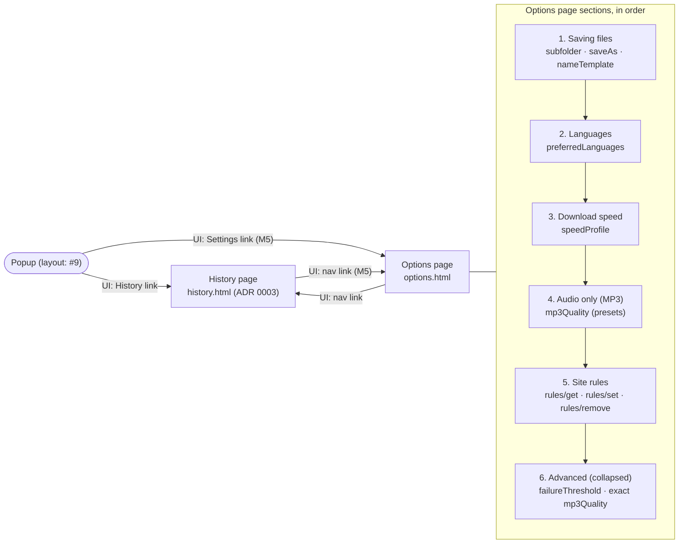
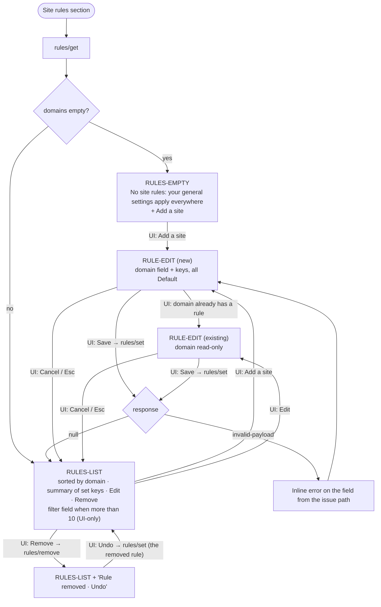

# Information architecture of the options page and history

- Status: draft for D2 — Flows & IA
- Issue: #10
- Inputs: `docs/brief.md`, `references/ui-contract.md` §4.3–§4.4, `references/design.md` §6–§7, `docs/flows/core-flows.md`
- Decisions: [ADR 0003](../decisions/0003-history-own-page.md) (where history lives), [ADR 0004](../decisions/0004-options-page-structure.md) (options page structure and rules editor model)

How the two secondary surfaces are organized before any wireframe: what the options page contains and in which order, how per-site rules are edited, and how history works and where it lives. The [information architecture](../process.md#glossary) is [contract-first](../process.md#glossary): every control maps to a `Settings` or `DomainRule` field or to a §4.3/§4.4 request; anything else is UI-only (navigation, filtering, formatting) and sends nothing. Basic vs advanced follows [progressive disclosure](../process.md#glossary): Marina (persona) sees the basic layer only and never needs to open the advanced one.

## 1. Map

- Both pages are extension pages opened in a browser tab. The options page is declared with `options_ui.open_in_tab: true` (a recommendation for servare's manifest, not a contract change), so Firefox does not embed it in the narrow `about:addons` frame and both browsers show the same layout.
- Both pages reflow down to 320 CSS px (WCAG 1.4.10), so their components also fit the future 380px sidebar.
- Links are hidden when the target is not available yet: the History link while `history/list` answers `unknown-request` (before servare #15), the Settings link while `settings/get` does (before M5). See brief, Transport.

## 2. Options page

### 2.1 Sections and order

Order follows how often Marina's tasks touch each setting and how directly it changes what the popup does (brief task 6): where files go and what they are called affects every save; languages decide what the popup preselects (F1, D-F2); speed and MP3 are occasional; site rules are a fix for a specific site; the advanced layer is last and collapsed.

| #   | Section (heading copy is the writer's, D3) | Fields                                                  | Layer                                                                                                |
| --- | ------------------------------------------ | ------------------------------------------------------- | ---------------------------------------------------------------------------------------------------- |
| 1   | Saving files                               | `subfolder`, `saveAs`, `nameTemplate`                   | Basic                                                                                                |
| 2   | Languages                                  | `preferredLanguages`                                    | Basic                                                                                                |
| 3   | Download speed                             | `speedProfile`                                          | Basic                                                                                                |
| 4   | Audio only (MP3)                           | `mp3Quality` as three presets                           | Basic                                                                                                |
| 5   | Site rules                                 | `DomainRule` list and editor (§3)                       | Section is basic; inside each rule, keys are split basic/advanced (§3.3)                             |
| 6   | Advanced                                   | `failureThreshold`, `mp3Quality` as the exact level 0–9 | Advanced: one disclosure, closed by default, its open state remembered locally by the page (UI-only) |

Navigation: a list of in-page anchors to the six sections plus a link to History. On wide windows it sits at the inline-start side; under ~720px it becomes a single row above the content. One `<h1>` for the page, one `<h2>` per section.

### 2.2 Controls per setting

| Field                | Control                                                                                                                                                                                                                                                                                                                                                                                                                                                                  | Basic / advanced |
| -------------------- | ------------------------------------------------------------------------------------------------------------------------------------------------------------------------------------------------------------------------------------------------------------------------------------------------------------------------------------------------------------------------------------------------------------------------------------------------------------------------ | ---------------- |
| `subfolder`          | Text field "Folder inside your downloads folder", empty = root. Help text says it is created inside the downloads folder; never names that folder "Downloads" (G1 rule).                                                                                                                                                                                                                                                                                                 | Basic            |
| `saveAs`             | Checkbox "Ask where to save each file". When on, the subfolder field stays editable; whether it is still used is asked in G19.                                                                                                                                                                                                                                                                                                                                           | Basic            |
| `nameTemplate`       | Text field with one insert button per design §7 variable, labeled in plain words (Title `{title}`, Site `{host}`, Date `{date}`, Quality `{quality}`, Language `{lang}`), and an example line "Example: Sample video.mp4" computed in the UI from fixed sample values. The example is an approximation: sanitization is the background's (design §7) and a preview request is proposed in G19. Raw `{…}` syntax stays visible in the field, so a power user can type it. | Basic            |
| `preferredLanguages` | Ordered list of languages shown by name (`Intl.DisplayNames` in the UI language, local), with Add (from a bundled list of language codes), Move up/down buttons and Remove. Empty state offers "Use my browser languages" from `navigator.languages` (local). Order is shown as priority; whether order matters is asked in G19. Free BCP 47 code entry sits in Advanced of the add dialog.                                                                              | Basic            |
| `speedProfile`       | Radio group of three: Economy / Standard / Fast, each with a one-line effect in plain words ("Gentler on the site and your connection", …). Says that site rules can override it.                                                                                                                                                                                                                                                                                        | Basic            |
| `mp3Quality`         | Basic: radio group of three presets, Best sound = `0`, High = `2` (default), Smaller files = `5`. A stored value outside the presets selects a fourth option "Custom (level N)". Advanced: the exact level 0–9 as a slider with end labels "Best sound" (0) and "Smallest file" (9).                                                                                                                                                                                     | Both             |
| `failureThreshold`   | Number field in percent, 0–100, step 1, "Stop a download when more than N% of its parts fail". Display is `Math.round(value * 100)` (0.2 shown as 20, never 7.000000000000001); the UI writes `N / 100`. A stored value that is not a whole percent (0.333) shows rounded and is only rewritten when the user changes it. Help text explains 0 and 100.                                                                                                                  | Advanced         |

### 2.3 Load and save model

- **Load:** one `settings/get` and one `rules/get` on open. Sections render from the responses; no field shows a value the background did not return.
- **Save settings: on change, per field.** Each committed change (radio/checkbox change, text field on blur or Enter) sends `settings/set` with that one field (`Partial<Settings>`). The response is the full `Settings`, which replaces the page state. A polite live region says "Saved". No global Save button: there is nothing to forget, and a half-edited page cannot be lost.
- **Errors:** `invalid-payload` maps each issue path to its field (inline error, `aria-describedby`, focus stays); the field keeps the user's text so it can be corrected; the stored value is unchanged. Other failure codes use the request-failure pattern of F8.
- **Restore defaults:** a per-section "Restore defaults" sends the documented defaults from contract §4.4. Whether servare can expose defaults itself (so the UI never hard-codes them) is asked in G19.
- **Background changes:** the page re-renders from `settings/updated` (contract §5, planned #34, "settings or rules changed"). Its payload carries `Settings` only, so the page also re-fetches `rules/get` on it (G18). Events sent while the port is disconnected are lost (§1), so the page re-fetches `settings/get` and `rules/get` on reconnect and when the tab becomes visible again.

## 3. Site rules editor

### 3.1 Model

`rules/get` returns `{ version: 1, domains: Record<string, DomainRule> }`. The editor treats each domain as one unit: it reads the whole rule, edits a copy, and writes it back with `rules/set { domain, rule }` on Save. Removing is `rules/remove { domain }`.

**Missing key = "Default".** Every `DomainRule` key is optional and falls back to the default (§4.4). The editor keeps that meaning: each key has three states, **Default** (key absent), **On** and **Off** (or a value). The editor writes only the keys the user set; choosing Default deletes the key from the rule. It never fills absent keys with the current default, so a later change of defaults in servare still reaches the site. A rule with no keys left is still a valid rule; Save offers to remove it instead ("This rule changes nothing. Remove it?").

What "Default" resolves to:

| Key                                                                                      | Default shown as                                                                                                                                                                |
| ---------------------------------------------------------------------------------------- | ------------------------------------------------------------------------------------------------------------------------------------------------------------------------------- |
| `speedProfile`                                                                           | "Same as general setting (Standard)", reading `Settings.speedProfile`, which §4.4 names as the global default a rule overrides.                                                 |
| `detection`, `audioOnly`, `feedMode`, `hideFragments`, `propagateQuery`, `minDirectSize` | "Default", without a value. Contract and design §6 do not document the per-key defaults (the §6 example is a sample rule, not the defaults). Showing the value is asked in G18. |

### 3.2 List, add, edit, remove

- **List.** Sorted by domain in the UI (the order of a `Record` is not meaningful), with subdomains under their parent ( `example.com`, then `video.example.com`). Each row: domain, a summary of only the keys that are set ("Finding videos off · Speed: Economy"; "Uses defaults" when none), Edit, Remove. A text filter appears above 10 rules (UI-only).
- **Add.** One field for the site. The UI trims and lowercases it and strips a pasted scheme, path and port before sending (`https://www.example.com/watch` → `www.example.com`), shows the result before Save, and states that the rule also applies to subdomains (design §6). Validation is the background's (`invalid-payload`); accepted forms (IDN, leading dot, wildcards) are asked in G18. If the domain already has a rule, the editor opens that rule instead of overwriting it.
- **Edit.** The domain is read-only. Renaming is "remove and add": a rename would need `rules/set` plus `rules/remove`, two requests that can fail halfway, and the contract has no atomic rename.
- **Editor form.** On wide windows a panel next to the list; under ~720px it replaces the list (Back returns to it). Save and Cancel; Esc cancels; focus returns to the row (or to Add) afterwards. Leaving with unsaved changes asks once.
- **Remove.** No confirmation; an "Undo" toast for ~8 seconds re-sends `rules/set` with the removed rule (an exact restore, since the UI has the whole rule). The toast is a live region and its Undo is reachable by keyboard; it does not time out while focused.
- **Overlap.** A rule for `example.com` and one for `video.example.com` can both exist. Which wins, and whether they merge per key, is not documented (G18); the list shows both and the row of a subdomain says "Also covered by example.com" (UI-derived from the domain names).
- **Bundled rules.** Servare ships `default-rules.json` (§4.4). Whether its entries appear in `rules/get`, and whether removing one survives an update, is not documented (G18). Until then the list shows whatever `rules/get` returns, without a "built-in" marker.
- **Unknown version.** If `rules/get` returns a `version` other than `1`, the section shows the list read-only with a notice; it never writes rules it cannot read.
- **Not available.** If `rules/*` answers `unknown-request`, the Site rules section and its nav link are hidden.

### 3.3 Rule keys: controls and layer

| Key              | Control in the editor                                                                                       | Layer    |
| ---------------- | ----------------------------------------------------------------------------------------------------------- | -------- |
| `detection`      | "Find videos on this site": Default / On / Off                                                              | Basic    |
| `audioOnly`      | "This site has audio only" (treat streams as audio): Default / On / Off                                     | Basic    |
| `speedProfile`   | "Download speed": Same as general setting (current value) / Economy / Standard / Fast                       | Basic    |
| `minDirectSize`  | "Ignore files smaller than": Default, or a number with a unit (KB / MB); stored in bytes (KB = 1024 bytes)  | Advanced |
| `hideFragments`  | "Hide video pieces when the full stream was found" (fragments vs manifest): Default / On / Off              | Advanced |
| `feedMode`       | "Keep a running list on pages that scroll forever" (feed mode): Default / On / Off                          | Advanced |
| `propagateQuery` | "Copy the stream's address parameters to its parts" (manifest query string to segments): Default / On / Off | Advanced |

Default / On / Off is a native `<select>` per key (one tab stop each, keyboard-native); seven three-way radio groups would make the editor long for a power-only feature. Technical terms appear only in the expandable help of each advanced key. The advanced keys sit behind one "More options for this site" disclosure, opened automatically when the rule already sets one of them.

## 4. History

### 4.1 Where it lives

Its own extension page, `history.html`, opened in a tab from a "History" link in the popup and from the options page navigation. Rationale and alternatives in [ADR 0003](../decisions/0003-history-own-page.md); the short version: history ships in M1 (servare #15) while the options page arrives in M5, a growing list with search and "Clear all" needs more room and stability than a popup that closes on blur, and keeping it out of the popup leaves the popup structure (#9) free.

Constraint for #9: whatever structure the popup takes, it keeps one visible "History" entry point and does not render `HistoryEntry` data itself.

### 4.2 Relation to the popup's finished jobs

| Popup (download queue)                                                                    | History page                                                                      |
| ----------------------------------------------------------------------------------------- | --------------------------------------------------------------------------------- |
| `DownloadJob` from `download/list` and `job/updated`                                      | `HistoryEntry` from `history/list`                                                |
| Jobs in `download/list`, persisted until removed (design §4.10), any status; see G14, G17 | Only finished downloads: `status` `done` or `failed`; cancelled jobs never appear |
| Dismissing a card is `download/remove`                                                    | Removing an entry is `history/remove`                                             |
| Includes private-window jobs while they exist                                             | Never includes private-window jobs (§4.3)                                         |
| Actions on the job: pause, resume, cancel, retry, stop                                    | Actions on the record: open page, remove, clear; open file waits on G1            |

- The two stores are separate. A done job appears in both, and the popup does not hide it because history has it.
- Dismissing a popup card must not erase the history entry. That is G17; until it is confirmed, the popup follows the D-F3 fallback.
- Removing or clearing history never touches the popup's jobs (no request links them).
- Nothing in the contract links an entry to its job (G20). The history page renders from `history/updated` (contract §5, planned #15, `{ entries }`), and re-fetches `history/list` on reconnect and when the tab becomes visible, since events sent while disconnected are lost (§1). How a full-list `entries` payload relates to `limit` and paging is asked in G20 and G3.

### 4.3 Sorting, grouping and finding

- **Order:** newest first by `completedAt`, sorted in the UI (the `history/list` order is not documented, G20). No user-selectable sort: Marina looks for "the one I saved last week", and time is how she remembers it.
- **Grouping:** by day, "Today", "Yesterday", then dates via `Intl.DateTimeFormat` in the UI language.
- **Finding:** a search field filters `title`, `outputName` and the host of `pageUrl` in the UI (G3 fallback). The page asks `history/list { limit: 500 }`; if exactly 500 come back, the end of the list says older downloads are not shown (G3).

### 4.4 Entry row

| Element           | Source                                                                 | Layer   |
| ----------------- | ---------------------------------------------------------------------- | ------- |
| Title             | `title`; empty → `outputName`; both empty → host of `pageUrl`          | Basic   |
| Placeholder glyph | Audio or video, from the `outputName` extension (G13 fallback)         | Basic   |
| Site              | Host of `pageUrl`                                                      | Basic   |
| Time              | `completedAt`, time of day inside its day group                        | Basic   |
| Size              | `bytes`, formatted with `Intl.NumberFormat` units; hidden when `0`     | Basic   |
| Status            | Only for `failed`: "Did not finish" (G2 fallback); `done` has no badge | Basic   |
| File name         | `outputName`                                                           | Details |
| Format            | `kind` (`direct` / HLS / DASH)                                         | Details |
| Full page address | `pageUrl`                                                              | Details |

Actions per row:

- **Open page:** a link to `pageUrl` (new tab). For `failed` it is labeled "Try again on the page" (G2 fallback; there is no retry from history).
- **Open file / Show in folder:** not offered until G1 is answered.
- **Remove:** `history/remove { entryId }`, immediately, no confirmation. The label says what it does and does not do: "Remove from history" with help "The file stays on your computer". No Undo: the contract has no request to put an entry back. Focus moves to the next row (or the previous one, or the search field).

### 4.5 Clear all

"Clear history" at the page level, enabled only when the list has entries. A modal dialog states the count and that files stay on the computer, with "Clear history" and "Cancel" (Cancel focused by default). Confirm sends `history/clear {}`; the page then shows `HIST-EMPTY`. When a search filter is active, Clear still clears everything, and the dialog says so.

### 4.6 Private-window note

Private jobs never appear in history (§4.3, design principle 4). The page says this in two places, in calm wording and without blame:

- `HIST-EMPTY`: "Downloads you finish will show up here. Downloads from private windows are never kept."
- At the end of a non-empty list, a one-line footnote with the same second sentence.

The popup cannot say "not added to history" on a private job's done card, because `DownloadJob` does not say whether its tab was private (G20). The history page opened from a private window shows the same (non-private) history, since the extension page is not the private tab.

### 4.7 States

| ID                   | When                                                  | Shows                                                    |
| -------------------- | ----------------------------------------------------- | -------------------------------------------------------- |
| `HIST-LOADING`       | `history/list` pending                                | Skeleton rows, `aria-busy`                               |
| `HIST-EMPTY`         | Response is `[]`                                      | Empty message + private note; Clear disabled; no search  |
| `HIST-LIST`          | Entries                                               | Day groups, rows, search, Clear                          |
| `HIST-NO-MATCH`      | Search filters everything out                         | "Nothing matches '…'" + Clear search                     |
| `HIST-TRUNCATED`     | Exactly `limit` entries returned                      | End-of-list note (G3)                                    |
| `HIST-CONFIRM-CLEAR` | Clear activated                                       | Modal dialog (§4.5)                                      |
| `HIST-ERROR`         | Request failure                                       | F8 request-failure pattern with Try again                |
| (no page)            | `history/list` answers `unknown-request` (before #15) | The History link is hidden in the popup and options page |

These extend the [state inventory](../discovery/state-inventory.md), which covers the popup only; D4 adds them to the gallery.

## 5. Field placement

Every field of `Settings` and `DomainRule` (contract §4.4) and of `HistoryEntry` (§4.3), with its place. No other field is used.

### 5.1 `Settings`

| Field                | Type (contract)                     | Section          | Control                                 | Layer                       | Write                         |
| -------------------- | ----------------------------------- | ---------------- | --------------------------------------- | --------------------------- | ----------------------------- |
| `nameTemplate`       | `string`                            | 1 Saving files   | Text field + variable buttons + example | Basic                       | `settings/set` on blur/Enter  |
| `subfolder`          | `string`                            | 1 Saving files   | Text field                              | Basic                       | `settings/set` on blur/Enter  |
| `saveAs`             | `boolean`                           | 1 Saving files   | Checkbox                                | Basic                       | `settings/set` on change      |
| `preferredLanguages` | `string[]` (BCP 47)                 | 2 Languages      | Ordered list: add, move, remove         | Basic (free code: advanced) | `settings/set` on each change |
| `speedProfile`       | `'economy' \| 'standard' \| 'fast'` | 3 Download speed | Radio group                             | Basic                       | `settings/set` on change      |
| `mp3Quality`         | `number` 0–9                        | 4 Audio only     | Presets 0 / 2 / 5 (+ Custom)            | Basic                       | `settings/set` on change      |
| `mp3Quality`         | (same field)                        | 6 Advanced       | Slider 0–9                              | Advanced                    | `settings/set` on change      |
| `failureThreshold`   | `number` 0–1                        | 6 Advanced       | Percent field 0–100                     | Advanced                    | `settings/set` on blur/Enter  |

7 of 7 fields placed.

### 5.2 `DomainRule`

| Key              | Type (contract)                     | Editor group               | Control                                     | Layer    | Absent key means        |
| ---------------- | ----------------------------------- | -------------------------- | ------------------------------------------- | -------- | ----------------------- |
| `detection`      | `boolean`                           | Main                       | Default / On / Off                          | Basic    | Default (value: G18)    |
| `audioOnly`      | `boolean`                           | Main                       | Default / On / Off                          | Basic    | Default (value: G18)    |
| `speedProfile`   | `'economy' \| 'standard' \| 'fast'` | Main                       | Same as general / Economy / Standard / Fast | Basic    | `Settings.speedProfile` |
| `minDirectSize`  | `number` (bytes)                    | More options for this site | Default, or number + KB/MB                  | Advanced | Default (value: G18)    |
| `hideFragments`  | `boolean`                           | More options for this site | Default / On / Off                          | Advanced | Default (value: G18)    |
| `feedMode`       | `boolean`                           | More options for this site | Default / On / Off                          | Advanced | Default (value: G18)    |
| `propagateQuery` | `boolean`                           | More options for this site | Default / On / Off                          | Advanced | Default (value: G18)    |

7 of 7 keys placed. The rule's domain is the `Record` key (`rules/set { domain }`), shown as the row title and the editor's site field. `version` is read, never shown or written.

### 5.3 `HistoryEntry`

| Field         | Place                                |
| ------------- | ------------------------------------ |
| `id`          | `history/remove { entryId }` only    |
| `title`       | Row title (fallbacks in §4.4)        |
| `pageUrl`     | Site (host), Open page link, Details |
| `outputName`  | Details; title fallback; glyph       |
| `kind`        | Details                              |
| `completedAt` | Day group, time, sort key            |
| `bytes`       | Size                                 |
| `status`      | "Did not finish" badge on `failed`   |

### 5.4 Requests used

`settings/get`, `settings/set`, `rules/get`, `rules/set`, `rules/remove`, `history/list`, `history/remove`, `history/clear`; events `history/updated` (history page) and `settings/updated` (options page; triggers a `rules/get` re-fetch); `PortClient` `onReconnect`. Every §4.3 and §4.4 request is used.

## 6. Gaps

Found here; details in [`contract-gaps.md`](../discovery/contract-gaps.md): **G18** (rule defaults, bundled rules, overlap precedence, accepted domain forms), **G19** (settings defaults, `preferredLanguages` order, file-name preview, `saveAs` with `subfolder`), **G20** (history order, retention, link to jobs, private flag on jobs). Reconfirmed: G1 (open file from history), G2 (why an entry failed), G3 (paging and search), G13 (thumbnail and audio mode in history), G17 (dismissing a job vs history).

## 7. Open questions for the maintainer

1. MP3 presets: are 0 / 2 / 5 the right three points, or should the basic layer be the 0–9 slider alone?
2. History search limit of 500 entries before the "older downloads not shown" note: acceptable until G3 is answered?
3. Should "Rules for this site" be reachable from the popup (opening the options page at that domain's rule) in M5, or is the options page the only entry?
